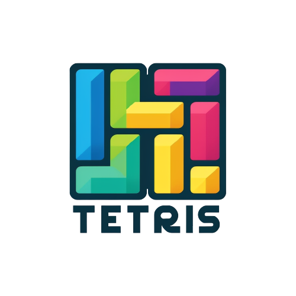
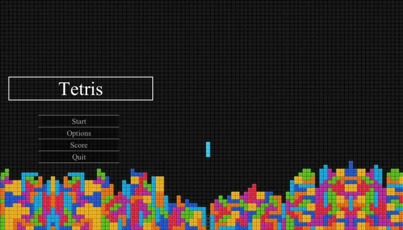
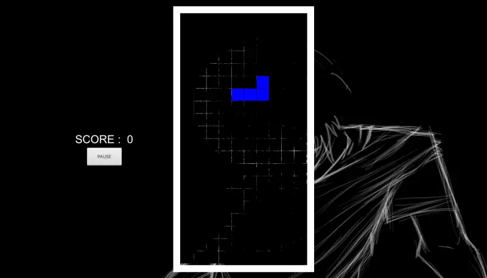

# Tetris

<p align="center">

</p>

[](https://github.com/LaCobble/Tetris_Java/actions/workflows/ci.yml)
[](LICENSE)


A Tetris game in Java and JavaFX, built as a team project for a school assignment.

<p align="center">


</p>

*Main menu and game screen, rendered from the real JavaFX scenes.*

## What it does

- Random generation of tetrominoes, which fall at a pace set by the difficulty.
- Move, rotate and hard-drop the current piece.
- Completed lines are cleared and add 10 points to the score.
- Pause / resume button; the game ends when a new piece cannot enter the board.
- Menu with **Start**, **Options** (difficulty: Easy, Medium, Hard, GodMode; credits), **Score** (top-3 podium) and **Quit**.

### Controls

The keys are laid out for an AZERTY keyboard:

| Key | Action |
| --- | --- |
| `Q` | Move left |
| `D` | Move right |
| `Z` | Rotate clockwise |
| `S` | Hard drop |

## Requirements

- JDK 17 with JavaFX 17: either a JDK that bundles JavaFX (for example Azul Zulu "JDK FX", used by the CI), or a plain JDK plus the [JavaFX SDK](https://gluonhq.com/products/javafx/).

## Build and run

With a JDK that bundles JavaFX:

```bash
git clone https://github.com/LaCobble/Tetris_Java.git
cd Tetris_Java
javac -encoding UTF-8 -d out $(find Tetris/src/main/java -name '*.java' ! -name module-info.java)
java -cp out:Tetris/src/main/resources com.example.tetris.Main
```

With a plain JDK and the JavaFX SDK, add `--module-path /path/to/javafx-sdk/lib --add-modules javafx.controls,javafx.fxml` to both commands.

The repository contains a Maven wrapper (`tetris/mvnw`) and a `module-info.java`, but the `pom.xml` was never committed (the root `.gitignore` ignores `*.xml`), so the build above uses `javac` directly.

## Project structure

```
Tetris/src/main/
├── java/com/example/tetris/
│   ├── Main.java               # Main menu (entry point)
│   ├── TetrisApplication.java  # Game screen: rendering, timers, keyboard input
│   ├── Game.java               # Game state: current piece, start, pause, end
│   ├── TetrisBoard.java        # Piece generation, line detection and clearing
│   ├── Board.java, Cell.java, Point.java, Tetromino.java
│   ├── OptionsPage.java, ScorePage.java, CreditPage.java
│   ├── HighScoreManager.java   # Reads the high scores from a CSV file
│   ├── Enum/TetrominoType.java
│   └── Interfaces/             # One interface per model class
└── resources/                  # Background images and icon
tetris/                         # Maven wrapper and module-info.java (IntelliJ project)
img/Tetris.png                  # Logo
```

On a case-insensitive file system (macOS, Windows), `Tetris/` and `tetris/` are merged into a single folder when cloning.

## What it demonstrates

- **Object modelling first**: the project started with a modelling phase (interfaces for the board, cells, points, tetrominoes and the game), then the implementation.
- Game loop with JavaFX `Timeline`s: one for the gravity tick, one for redrawing the board.
- Grid algorithms: collision checks, rotation, line completion and clearing.
- JavaFX UI: scenes, layouts, event handling, multiple windows (menu, options, scores, credits).
- Team work with Git on a shared repository.

## Context

School group project (2023). Two students worked on the object modelling, then a team of four on the programming: [@LaCobble](https://github.com/LaCobble), [@BNA-02](https://github.com/BNA-02), [@thomas192](https://github.com/thomas192) and [@Warzia1](https://github.com/Warzia1).

## Contributing

This is an archived learning project, but issues and pull requests are welcome: see [CONTRIBUTING.md](CONTRIBUTING.md) and the [Code of Conduct](CODE_OF_CONDUCT.md).

## License

[MIT](LICENSE) © LaCobble
